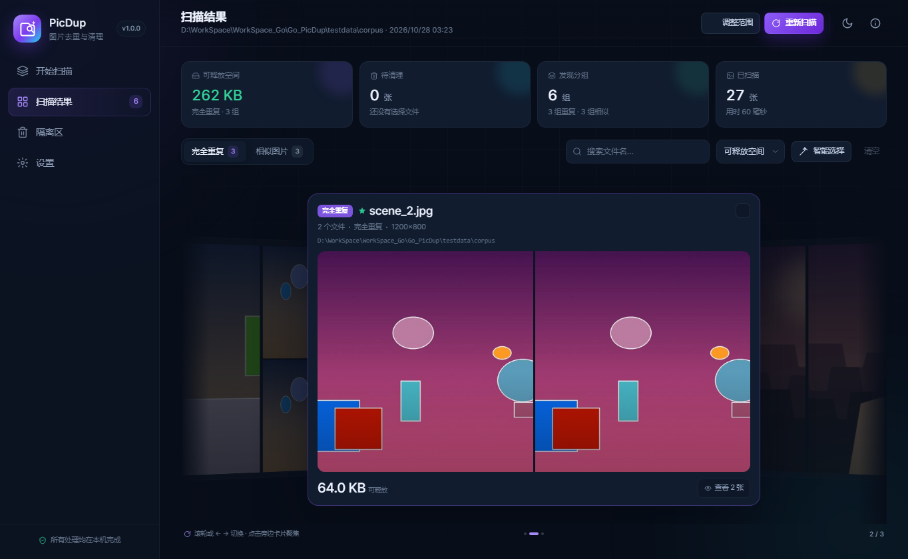
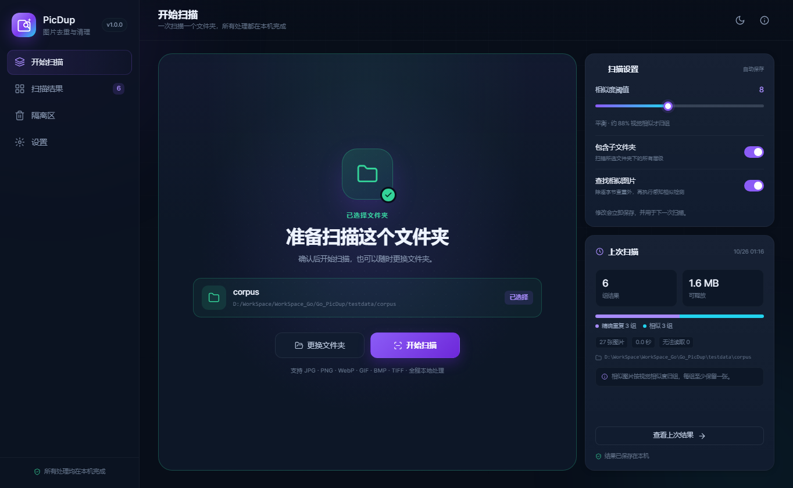
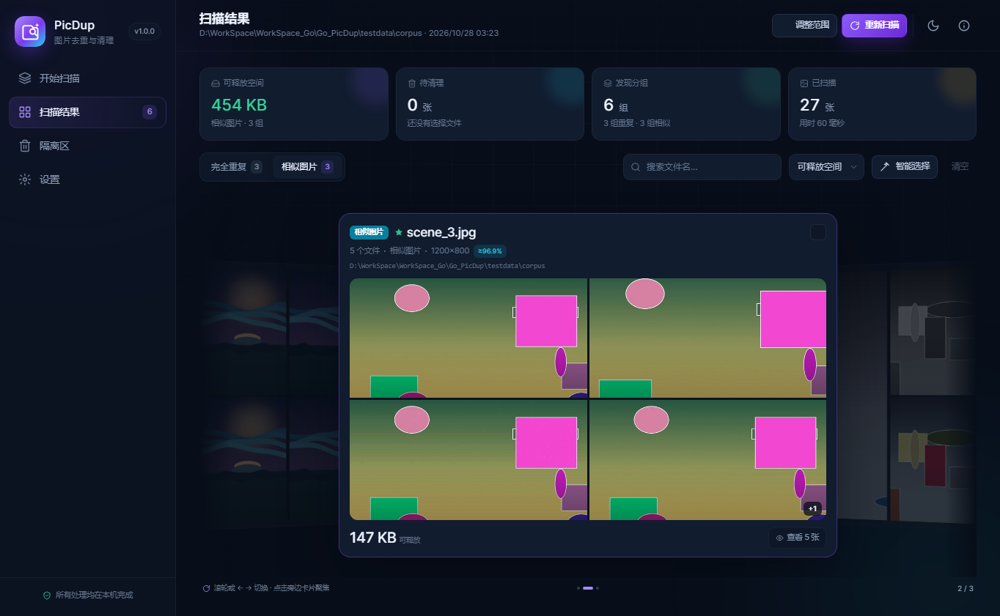
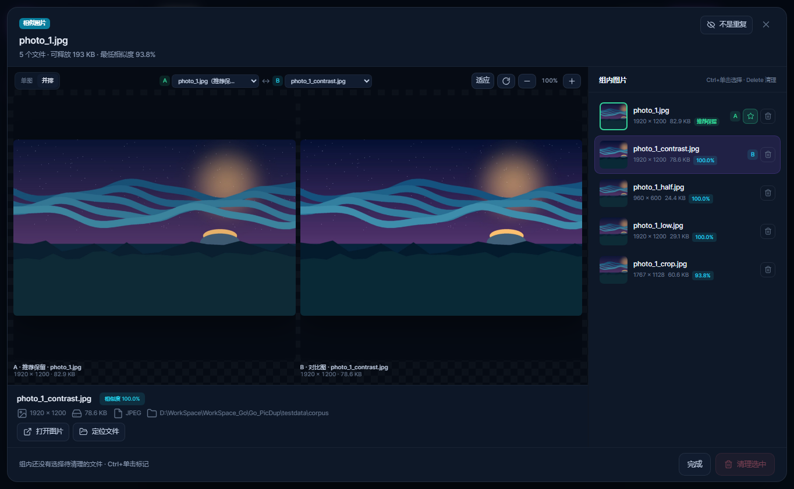
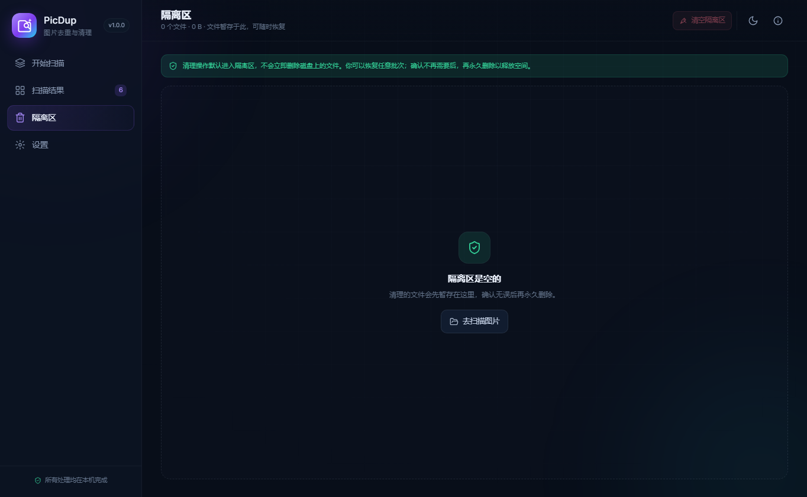
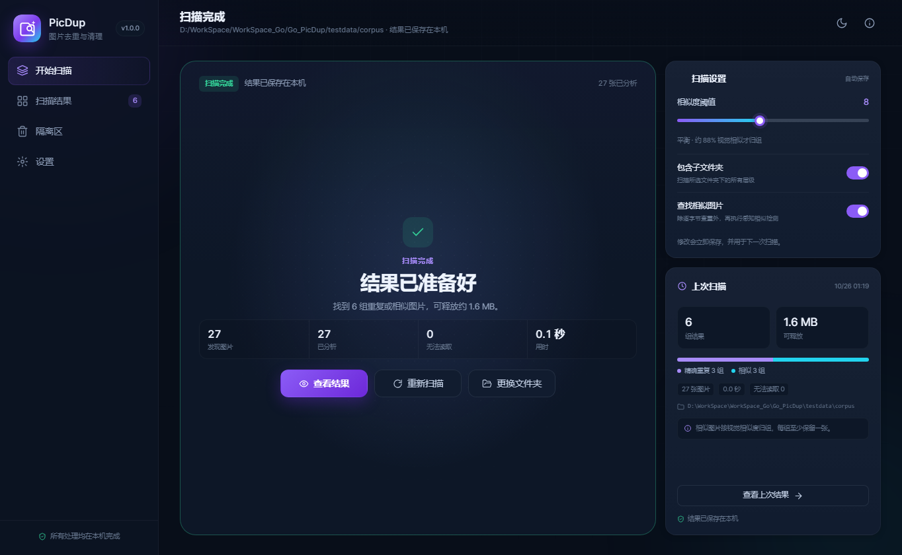
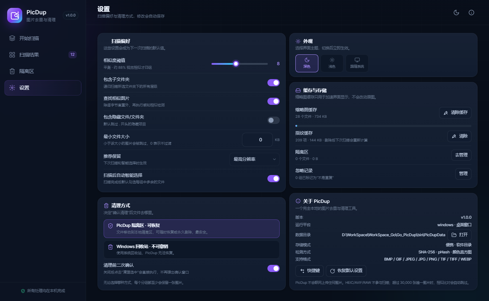

# PicDup · 图片去重与清理

> **开发说明：本项目全部由 AI 开发。**

PicDup 是一个 **完全本地运行** 的 Windows 桌面工具，用来找出重复与相似的图片，并在确认后安全地清理它们。界面使用 Go + Wails 3 + 原生 HTML/CSS/JS 构建，不需要前端构建步骤。



## 下载

Windows 版本发布在 [GitHub Releases](https://github.com/QQ510447097/PicDup/releases/latest)：

- **便携版**：`PicDup-v1.0.0-win64.zip`，解压后直接运行 `PicDup.exe`，数据保存在 exe 同目录的 `PicDupData`。
- **安装版**：`PicDup-v1.0.0-win64-setup.exe`，按当前用户安装到 `%LOCALAPPDATA%\Programs\PicDup`，创建开始菜单快捷方式，不需要管理员权限；卸载时保留 `PicDupData`。

需要 Windows 10/11 和 WebView2 Runtime（Windows 11 自带）。安装包会检测 WebView2，缺失时给出下载入口。

## 功能

- **扫描模块就地翻转**：开始扫描后主模块翻转为进度窗口，完成后可点「更换文件夹」翻回；右侧设置和上次扫描模块不受影响，切换页面再回来也会保留。
- **快速重扫**：未变化的文件直接复用指纹缓存；完全相同的文件只解码一次；缩略图在真正需要时生成。
- **一次一个文件夹**：每次只扫描一个文件夹，可选是否包含子文件夹；选择后在主窗口直接确认并开始扫描。
- **逐字节精确查重**：对每个文件计算 SHA-256，内容完全相同才会归为一组。
- **感知相似检测**：pHash（DCT 感知哈希）+ 中央裁剪指纹 + dHash + 4×4×4 颜色直方图，可以识别缩放、重新压缩、裁剪、调色后的图片变体。
- **卡片轮播结果**：结果以 3D 卡片轮播呈现，滚轮或左右方向键切换，首尾到头即止不回环；两张结果时自动变为双卡聚焦布局，不再拉伸或补空卡。
- **相似组并排对比**：相似分组可用 A/B 下拉框任选两张成员并排查看；也可点成员行快速设为 B、点当前 A 交换左右。支持滚轮缩放、拖拽平移和适应/重置。
- **不是重复**：在分组详情把误报组标记为“不是重复”，后续扫描不再提示；设置页可查看和恢复忽略记录。
- **便携数据**：设置、缩略图、指纹、隔离区默认放在 exe 同目录的 `PicDupData`，整套目录拷走即可；不可写时回退系统应用数据目录。
- **分组详情直接清理**：详情页可 Ctrl+单击多选、Delete 快捷键或“清理选中”按钮直接清理，仍遵循“清理前二次确认”设置。
- **清理前二次确认**：可在设置中关闭；关闭后点击“清理选中”会直接执行。
- **保留策略可调**：最高分辨率、文件最大、修改时间最新/最早、路径最短五种推荐保留规则，下次扫描生效。
- **缓存与维护**：分别查看和清除缩略图缓存、指纹缓存；在“关于”里可直接打开数据目录、查看快捷键或恢复默认设置。
- **自动推荐保留**：相似组优先保留分辨率最高、文件最大的一张；重复组优先保留路径更短、时间更早的一份。
- **智能选择**：一键选中每组中除推荐保留项之外的所有文件，也可以逐组、逐张调整。
- **安全清理**：扫描后发生变化的文件会再次校验大小与修改时间，不一致就自动跳过，避免误删被替换的文件。
  - 默认移入 **PicDup 隔离区**，可随时恢复，支持一次清理的撤销；
  - 也可以在设置中切换为 **Windows 回收站** 模式（不可由 PicDup 撤销）；
  - 服务端会再次校验：每个分组至少要保留一张图片，绝不会把一整组全部删掉。
- **本地隔离区**：按批次查看、恢复、永久删除或清空。
- **扫描结果持久化**：关闭应用后重新打开，仍能查看上次扫描结果（缩略图按需从缓存重建）。
- **深色 / 浅色 / 跟随系统** 主题，中文界面。
- 支持 JPG / JPEG / PNG / GIF / BMP / WebP / TIFF，读取 EXIF 方向；跳过隐藏文件、系统目录和符号链接。
- 所有图片、指纹和缩略图都只保存在本机，不会联网上传。

## 界面预览

| 开始页 | 相似图片 |
| --- | --- |
|  |  |

| 分组详情 | 隔离区 |
| --- | --- |
|  |  |

| 扫描完成 | 设置 |
| --- | --- |
|  |  |

## 构建

### 环境要求

- Windows 10 / 11，系统已安装 WebView2 Runtime（Windows 11 自带；Win10 一般随 Edge 安装）。
- Go 1.26 或更新版本（Wails v3.0.0-beta.34 要求）。
- [Wails 3 CLI](https://v3.wails.io/)（生成 Windows 图标与清单资源；没有它也可以构建，只是 exe 不带图标/版本资源）。
- 构建桌面壳不需要 Node.js，也不执行 `npm install`。

### 构建发布版

```powershell
.\build.ps1
```

产物：`bin\PicDup.exe`（无控制台窗口）。脚本会调用 `wails3 generate syso` 把 `build/windows/icon.ico`、应用清单和版本信息链接进 exe，然后使用 `-tags production -ldflags="-w -s -H windowsgui"` 构建。

安装包使用 Inno Setup 6 编译：

```powershell
ISCC.exe installer\PicDup.iss
```

产物：`dist\PicDup-v1.0.0-win64-setup.exe`。

其他模式：

```powershell
.\build.ps1 -Mode dev      # bin\PicDup-dev.exe，带控制台，方便看日志
.\build.ps1 -Mode server   # bin\PicDup-server.exe，无窗口本地 HTTP 服务
```

没有 `wails3` 时也可以直接：

```powershell
go build -tags production -ldflags="-H windowsgui" -o bin/PicDup.exe .
```

### 开发与测试

```powershell
# 直接运行 GUI（开发模式，会显示控制台日志）
go run .

# 浏览器调试模式：打开 http://127.0.0.1:8080
go run . --server --port 8080

# 单元测试 + 集成测试（testdata/corpus 存在时）
go test ./...
```

桌面窗口可加 `--debug-port 9224` 打开 WebView2 远程调试，便于自动化检查（仅开发用）。

## 使用

1. 点击“选择文件夹”或把文件夹拖进窗口。
2. 调整相似度阈值。数值越小越严格；默认 `8` 适合大多数照片，找出裁剪较多的图片时可以试试 `10–12`。
3. 点击“开始扫描”。扫描完成后，默认按“可释放空间”排序。
4. 在“完全重复”和“相似图片”两个标签页里逐组查看；也可以点击“智能选择”快速勾选每组多余的文件。
5. 点击“清理选中”，确认后文件进入隔离区。
6. 到“隔离区”页面恢复某个批次，或永久删除以释放磁盘空间。

### 键盘快捷键

- 扫描结果页：`←` / `→` 或滚轮切换上一组/下一组；`Ctrl+O` 更换文件夹；`/` 搜索。
- 分组详情：`Ctrl+单击` 标记或取消标记图片；`Delete` 清理已标记图片；`Esc` 取消确认或关闭详情。

### 隔离区与撤销

- 清理后右下角 toast 会提供“撤销”，可立即把该批次恢复回原路径。
- 恢复时如果原路径已被占用，会自动改名为 `xxx (恢复 1).jpg`，不会覆盖现有文件。
- 跨磁盘清理会自动退化为“复制 + 删除”，恢复同样支持跨磁盘。

## 性能

- 扫描指纹按 `路径 + 大小 + 修改时间` 缓存在应用数据目录，重扫未修改文件时不再读取和解码。
- SHA-256 完全相同的文件共享一次解码与指纹计算；每个路径仍参与精确查重。
- 缩略图改为按需生成：扫描阶段不再为所有图片编码 JPEG，只有结果页实际显示时才生成。
- 默认使用 `min(NumCPU, 16)` 个分析 worker；可用环境变量 `PICDUP_WORKERS` 覆盖，例如 `PICDUP_WORKERS=8`。
- 每轮扫描的分段耗时写入应用数据目录下的 `picdup.log`（walk / analyze / group / hash / decode / fingerprint / cache）。
- 在本机 6 核、1080 个文件（122 MB、23 组重复）的测试库上：首次约 1.1 秒，缓存命中后约 15 毫秒。

## 目录结构

```text
.
├── main.go                        # Wails 窗口、服务模式入口
├── internal/core/
│   ├── engine.go                  # 扫描状态、清理、结果更新
│   ├── scan.go                    # 文件遍历与分析 worker
│   ├── imaging.go                 # SHA/pHash/dHash/直方图/缩略图/EXIF 方向
│   ├── group.go                   # 精确分组、相似聚类、保留项选择
│   ├── trash.go                   # 隔离区、恢复、永久删除
│   ├── recycle_windows.go         # Windows 回收站（SHFileOperationW）
│   ├── thumbs.go / fingerprints.go / store.go # 缩略图/指纹缓存、配置持久化
│   └── persist.go                 # 上次扫描结果快照
├── internal/server/               # 本地 HTTP API
├── frontend/                      # 手工 HTML/CSS/JS，无打包步骤
├── build/                         # 应用图标、清单、版本信息
├── installer/                     # Inno Setup 安装包脚本与中文语言文件
├── testdata/corpus/               # 程序生成的测试图（含重复/缩放/裁剪/调色变体）
└── tools/                         # 测试语料生成、图标、CDP 验证脚本
```

## 相似检测说明

- 先按内容 SHA-256 精确分组；相似检测在“每种不同内容取一个代表”的基础上进行两两比较，避免重复副本放大计算量。
- 相似判定同时要求 pHash 距离（含 78% 和 90% 中央裁剪指纹）、dHash 距离与颜色直方图交集通过阈值。
- 相似组会做一次“medoid 分割”，避免 A≈B、B≈C、A≉C 的链式误合并。
- 默认相似度阈值可以在侧边栏/设置里调整，真实百分比按 `(1 - hamming/64) × 100%` 显示，仅作直观参考。

已知限制：

- 不支持 HEIC / AVIF / RAW；这些文件不会进入扫描。
- 超过 30,000 张**唯一内容**图片时，相似比对会自动跳过以保护性能（精确查重不受影响）。
- 相似检测对大幅旋转、强透视变形、严重遮挡的识别能力有限。
- Windows 回收站模式依赖 `SHFileOperationW`；网络盘或权限不足时可能失败并显示在清理结果里。

## 应用数据

默认使用便携模式，所有数据在 exe 同目录的 `PicDupData`：

| 内容 | 路径 |
| --- | --- |
| 设置 | `PicDupData/settings.json` |
| 忽略记录 | `PicDupData/ignored.json` |
| 上次扫描结果 | `PicDupData/last-result.json` |
| 缩略图缓存 | `PicDupData/thumbs` |
| 指纹缓存 | `PicDupData/fingerprints.json` |
| 隔离区 | `PicDupData/trash` |
| WebView2 用户数据 | `PicDupData/webview` |

第一次启用便携目录时，会尝试把旧的设置、上次结果和隔离区迁移过来；如果 exe 目录不可写（例如放在 `Program Files`），会自动回退到系统应用数据目录，并在设置页的“关于”里显示实际路径。

测试时可以用 `--data <目录>` 把这些数据放到临时目录，避免污染真实环境。

## 支持的格式

支持 JPG/JPEG、PNG、WebP、GIF、BMP、TIFF。HEIC、AVIF、RAW 不参与扫描；设置页的“关于”里也会显示当前支持列表。

## 隐私

PicDup 不包含任何网络请求代码，扫描、指纹计算、缩略图、清理和恢复都在本机完成。唯一的外部打开操作是用户主动点击“打开图片/定位文件”时调用系统文件管理器。

## 第三方组件

- [Wails 3](https://github.com/wailsapp/wails) — MIT
- [golang.org/x/image](https://golang.org/x/image) — BSD-3-Clause
- [Inter](https://rsms.me/inter/) 字体 — SIL Open Font License 1.1，见 `frontend/Inter-LICENSE.txt`

## License

PicDup 源码使用 [MIT License](LICENSE)，Copyright (c) 2026 孤独雪 (guduxue)。内置第三方组件遵循各自许可证，详见 [THIRD_PARTY_NOTICES.md](THIRD_PARTY_NOTICES.md)。

`testdata/corpus` 中的图片由 `tools/gen_corpus.py` 和 `tools/gen_corpus_photos.py` 程序生成，仅用于测试。
